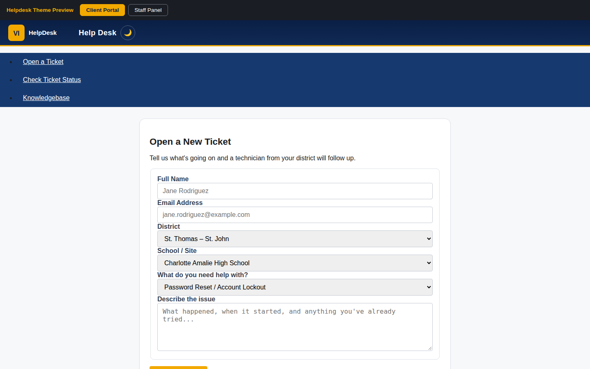
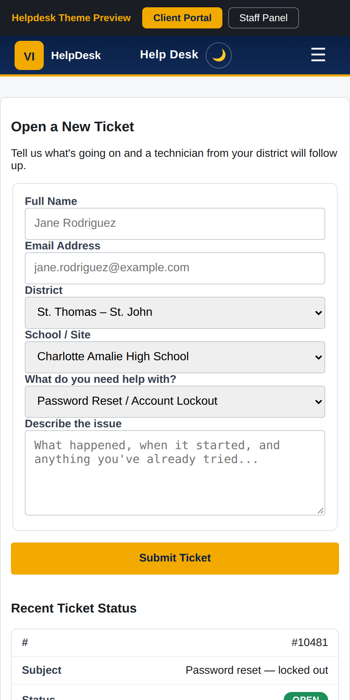
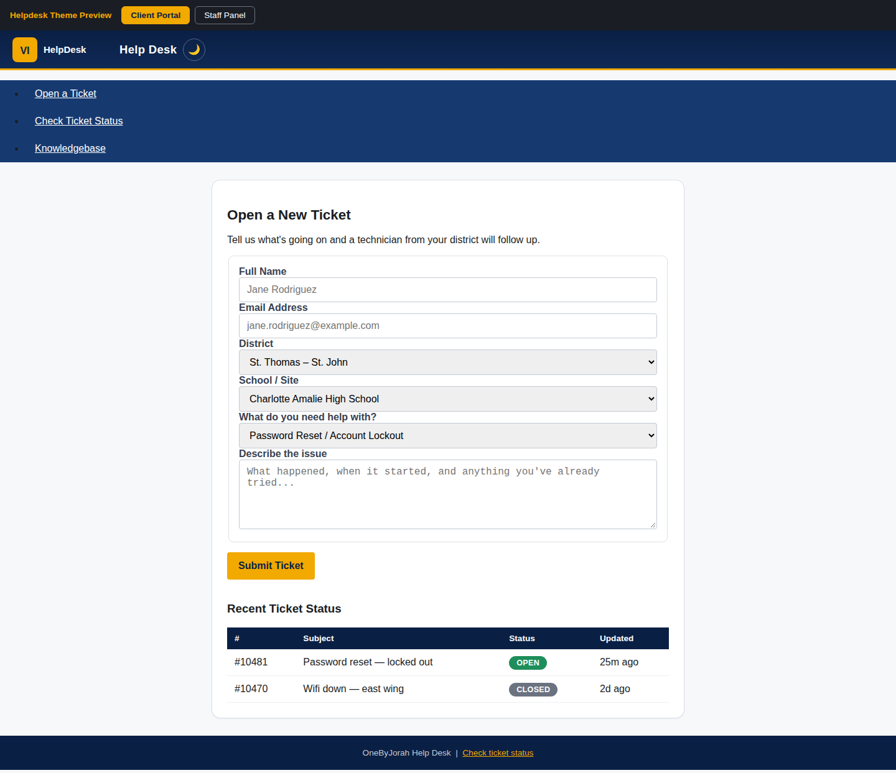

<div align="center">


# oshelpdesk

**A navy/gold helpdesk theme for osTicket 1.18.x — responsive, dark-mode-capable, and installed by a single script.**

<a href="https://github.com/OneByJorah/oshelpdesk/stargazers"></a>
<a href="https://github.com/OneByJorah/oshelpdesk/commits"></a>


</div>



## What This Is

oshelpdesk restyles the osTicket 1.18.x support portal and staff panel with a professional navy/gold identity. It ships as plain CSS and JS plus a bootstrap installer — no osTicket core logic is modified.

The theme is delivered through two stylesheet-plus-script pairs (client portal and staff panel) that read their colors and spacing from a single `helpdesk-tokens.css`. `deploy.sh` clones a pinned, official osTicket release, copies the theme assets into the expected paths, and auto-patches the two header includes so the theme loads — idempotently, with `.bak` backups.

## Quick Start

```bash
git clone https://github.com/OneByJorah/oshelpdesk.git && cd oshelpdesk
./deploy.sh                 # clones osTicket v1.18.2 into ./osticket and installs the theme
# or target an existing install:
./deploy.sh /var/www/html
```

Point your web server's document root at the target directory, then hard-refresh with **Ctrl+Shift+R**.

## Features

- **Navy/gold theme** — a consistent brand palette driven by one tokens file.
- **Client portal + staff panel** — separate stylesheets for each surface.
- **Dark mode support** — easy-on-the-eyes scheme.
- **Mobile responsive** — adapts to phones and tablets.
- **LDAP/AD compatible** — purely presentational; authentication is untouched.
- **No backend changes** — CSS/JS only; the installer injects header tags, it does not alter PHP logic.
- **Idempotent deploy** — marker-guarded injections (`HELPDESK-THEME-INJECT`) and `.bak` backups; safe to re-run.
- **Standalone previews** — `preview/index.html` and `preview/staff-preview.html` render the theme without an osTicket install.

## Install paths

### Automated (`deploy.sh`)

```bash
./deploy.sh [TARGET_DIR]        # default TARGET_DIR is ./osticket
OSTICKET_TAG=v1.18.2 ./deploy.sh
```

The script fetches the official osTicket source (this repo does not vendor a copy), copies `theme/css`, `theme/js`, and the logo asset, then patches:

- `include/client/header.inc.php` → tokens + client portal CSS/JS
- `include/staff/header.inc.php` → tokens + staff panel CSS/JS

### Manual injection

Follow [install/CLIENT_INJECTION.md](install/CLIENT_INJECTION.md) and [install/STAFF_INJECTION.md](install/STAFF_INJECTION.md) to add the `<link>` and `<script>` tags after osTicket's own stylesheet reference.

### File layout

```
oshelpdesk/
├── theme/
│   ├── css/     # helpdesk-tokens.css, helpdesk-client-portal.css, helpdesk-staff-panel.css
│   ├── js/      # helpdesk-client-portal.js, helpdesk-staff-panel.js
│   └── assets/  # helpdesk-logo-placeholder.svg, LOGO.md
├── install/     # CLIENT_INJECTION.md, STAFF_INJECTION.md
├── preview/     # index.html, staff-preview.html
└── deploy.sh
```

## Compatibility

| osTicket Version | Status |
|---|---|
| 1.18.x (tested on v1.18.2) | Fully tested |
| 1.17.x | May need adjustments |
| 1.16.x | Not tested |

## Use Cases

1. **MSPs and IT teams** — give a stock osTicket deployment an on-brand, professional look quickly.
2. **Self-hosted helpdesks** — ship a consistent portal + staff experience without touching PHP logic.

## Tech Stack

CSS3, vanilla JavaScript, Bash (installer), osTicket 1.18.x.

## Screenshots

| View | |
|---|---|
|  |  |
|  |  |

## Security

See [SECURITY.md](SECURITY.md). Report vulnerabilities privately to **security@jorahone.com**.

## Contributing

See [CONTRIBUTING.md](CONTRIBUTING.md). [Open an issue](https://github.com/OneByJorah/oshelpdesk/issues) for bugs or ideas.

## License

MIT — see [LICENSE](LICENSE).

## Connect

- [jorahone.com](https://jorahone.com)
- [GitHub Org](https://github.com/OneByJorah)
- [info@jorahone.com](mailto:info@jorahone.com)
